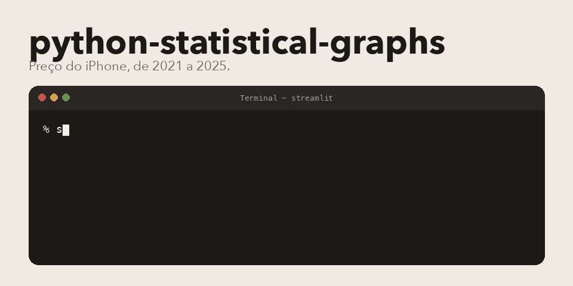

<p align="center">
  
</p>

Trabalho de probabilidade e estatística. Eu acompanhei o preço de lançamento do iPhone, do 13 ao 17, de 2021 a 2025, ao lado do salário mínimo. Tem a tela de apresentação e um editor para mexer nos números ao vivo.

Os valores de partida estão em `data_models.py`: base, Pro e Pro Max. O gif mostra dois deles.

## Do que é feito

Python, Streamlit, Plotly e pandas. São três arquivos de verdade: `app.py` escolhe a tela, `charts.py` desenha, `ui_components.py` monta o dashboard e o editor.

## Subir

```bash
python3 -m venv .venv
source .venv/bin/activate
pip install -r requirements.txt
streamlit run app.py
```

Abre em http://localhost:8501. Na barra lateral tem Dashboard e Editor. O botão de restaurar devolve a tabela original.

Pedro Américo Paletot, [peamericoo](https://github.com/peamericoo).
